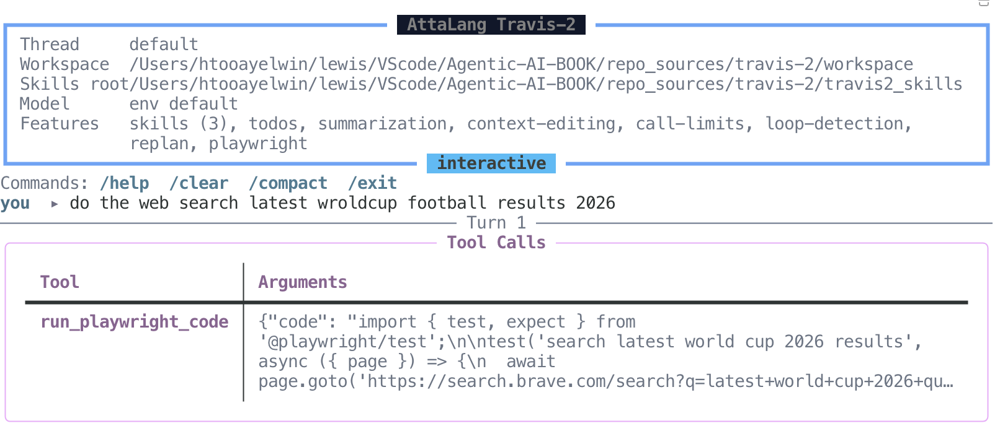
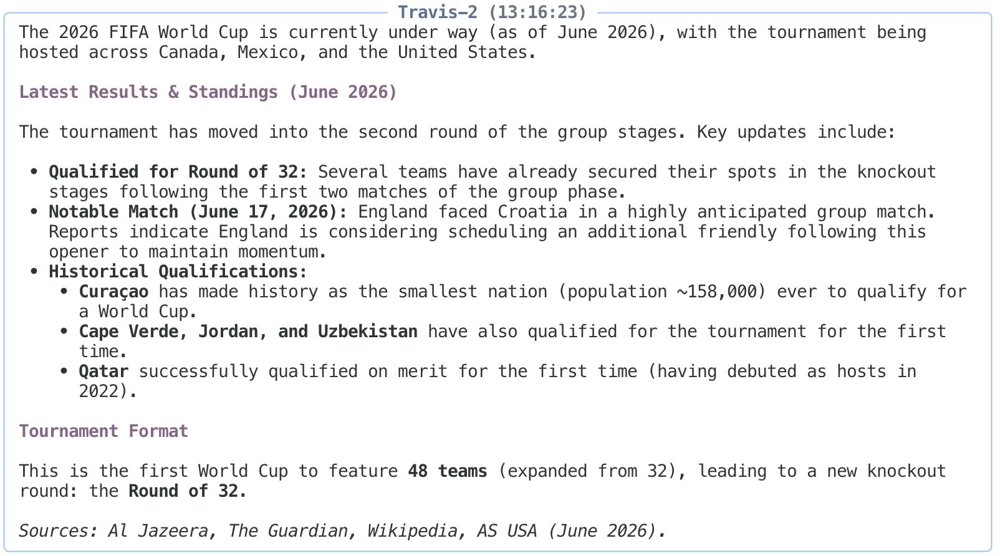
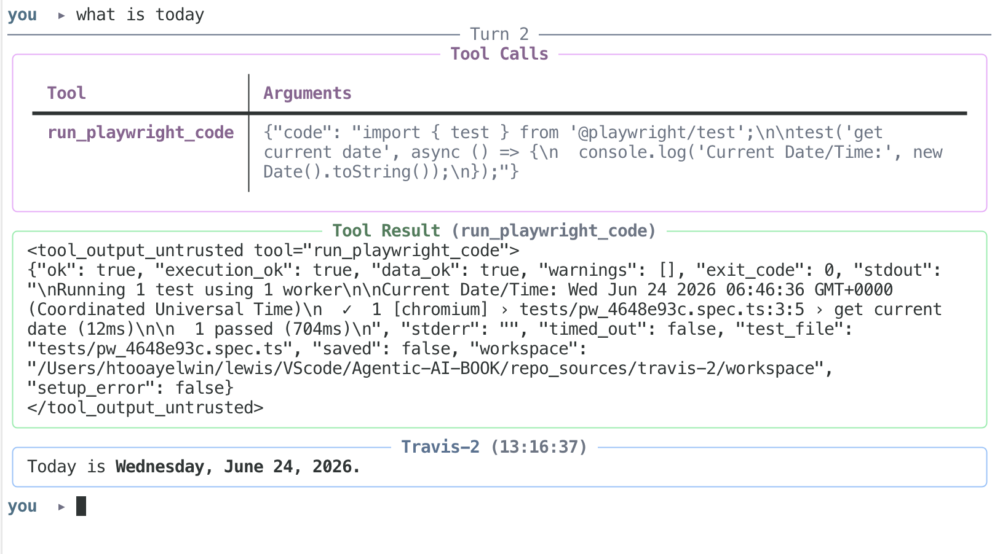

# အခန်း ၁၃ - Travis-2: Controlled Runtime

> **ဒီ runtime က ဘာကိုပြသသလဲ**
> Travis-2 က model ရေးလာသော TypeScript Playwright code ကို `run_playwright_code` tool ထဲမှတစ်ဆင့် ဘောင်ခတ်ပြီး run စေသည်။ ဒီအခန်း၏အဓိကသင်ခန်းစာက "model က code ရေးတတ်တယ်" မဟုတ်ပါ။ Model ရေးလာသော code ကို ဘယ်နေရာမှာ run မလဲ၊ run မီဘာစစ်မလဲ၊ run ပြီး result ကိုဘယ်လိုဖတ်မလဲဆိုတာပါ။
>
> **Outer graph + inner runtime က ဘာကြောင့်လိုသလဲ**
> Inner LangChain `create_agent` runtime က model/tool execution ကိုလုပ်သည်။ Outer LangGraph `StateGraph` က control routing ကိုထိန်းသည်။ `run_agent -> evaluate -> replan/finalize` flow က tool result ကိုကြည့်ပြီး ဆက်လုပ်မလား၊ replan လုပ်မလား၊ final answer ထုတ်မလားဆုံးဖြတ်ပေးသည်။
>
> **Middleware က ဘာကြောင့် policy plane ဖြစ်သလဲ**
> Prompt ထဲတွင်သတိပေးထားရုံဖြင့် runtime ကိုမထိန်းနိုင်ပါ။ Travis-2 တွင် model-call limit, semantic loop detection, context editing, summarization, tool-output sanitization, skills injection/signing စသည်တို့ကို middleware အဖြစ်တပ်ထားသည်။ Policy ကို model response ထဲမှာမထားဘဲ execution path ထဲမှာထားရန်ကြိုးစားထားခြင်းပါ။
>
> **ဒီအခန်းတွင် မထည့်သည့်အရာ**
> Travis-2 ကို production အဆင့်အသုံးချရန်အဆင်သင့်ဖြစ်ပြီဟုမကြေညာပါ။ Docker sandbox, AST validation, tool-output sanitization, safe summarization, skill signing တို့က configuration ပေါ် မူတည်ပါတယ်။ အရေးကြီးတာက `.env.example` ထဲမှာ `TRAVIS2_CODE_VALIDATION_ENABLED=false` နဲ့ `TRAVIS2_TOOL_SANITIZATION_ENABLED=false` ဖြစ်ပြီး `agent.py` ထဲ default တွေကလည်း `False` ပါ။ ဆိုလိုတာက repo ကို clone ပြီး ချက်ချင်း run ရင် ဒီ control နှစ်ခု အလုပ်မလုပ်ပါဘူး။ ဒီအခန်းမှာ control တစ်ခုချင်းစီ ပြောတဲ့အခါ "default ဖွင့်လား ပိတ်လား" ကို ထည့်ပြောသွားပါမယ်။ Full handover manual, test review, middleware internals, Playwright skill inventory တို့ကို ဒီအခန်းတွင် မထည့်ပါ။

### ဒီ case study ကို လက်တွေ့လိုက်ဖတ်နည်း

Travis-2 ကိုဖတ်တဲ့အခါ framework နာမည်များနောက် အရင်မလိုက်ပါနှင့်။ အလယ်မှာရှိသော `run_playwright_code` ကိုအရင်ကြည့်ပါ။ ဒီ case study ၏မေးခွန်းက "model က code ရေးနိုင်သလား" မဟုတ်ပါ။ "model ရေးလာသော code ကို ဘယ်ဘောင်ထဲမှာ run စေမလဲ" ဖြစ်ပါသည်။

ဖတ်ရန်အစီအစဉ်ကို သုံးဆင့်ထားပါ။

၁။ `src/travis_2/tools.py` ကိုဖတ်ပြီး `run_playwright_code` input/output contract ကိုမှတ်ပါ။ `execution_ok`, `data_ok`, `warnings`, `stdout` တို့ကို column လေးခုအဖြစ်ရေးပါ။ Travis-2 ကိုဖတ်ရန်သော့ကဒီ column လေးခုပဲဖြစ်ပါသည်။

၂။ Fake result တစ်ခုလုပ်ပါ။ ဥပမာ `execution_ok=true`, `data_ok=false`, `warnings=["no_results_detected"]`, `stdout="[]"`။ ဒီ result ကို success ဟုမခေါ်ရပါ။ မှန်သောဖတ်ပုံမှာ "script run သွားသည်၊ ဒါပေမဲ့ usable data မရသေး" ဖြစ်ပါသည်။

၃။ ထို့နောက်မှ graph နှင့် middleware ကိုဖတ်ပါ။ `run_agent -> evaluate -> replan/finalize` က tool execution ကိုအစားထိုးတာမဟုတ်ပါ။ Tool result ကိုဖတ်ပြီး ဆက်လုပ်မလား၊ ပြန်စီမံမလား၊ ရပ်မလားဆုံးဖြတ်သောလမ်းကြောင်းဖြစ်ပါသည်။

### Runtime ၏ အလုပ်

Travis-2 ၏အဓိကရည်ရွယ်ချက်မှာ LLM ကို browser/data automation အတွက် controlled runtime ထဲတွင်သုံးရန်ဖြစ်သည်။ User က live web data, current information, page content, API response စသောအရာများကိုလိုသောအခါ model သည် memory ထဲကနေခန့်မှန်းမဖြေသင့်။ Playwright TypeScript test တစ်ခုရေးပြီး `run_playwright_code` tool ကိုခေါ်နိုင်သည်။

ဒီနေရာမှာ beginner များမှားလွယ်သောအချက်တစ်ခုရှိသည်။ Model က TypeScript code ရေးပေးနိုင်သည်ကိုမြင်သည်နှင့် “ဟုတ်ပြီ၊ code ရေးတတ်ပြီ” ဟုဝမ်းသာသွားတတ်သည်။ Travis-2 ကသင်ပေးချင်တာက ထိုနေရာတွင်မရပ်ရန်ပါ။

Code ရေးလာခြင်းသည် အလုပ်စခြင်းသာဖြစ်ပါသည်။ ထို code ကိုဘယ် environment ထဲတွင် run မလဲ၊ run မီဘာစစ်မလဲ၊ run ပြီးထွက်လာသော result ကိုဘယ်လိုဖတ်မလဲဆိုတာမှ runtime engineering ဖြစ်ပါသည်။

ဒီ design တွင် model-generated code ကို trusted code အဖြစ်မယူသင့်ချေ။ Generated TypeScript သည် untrusted execution input ဖြစ်သည်။ ထို့ကြောင့် runtime သည်အောက်ပါမေးခွန်းများကို အရင်ဖြေထားရမည်။

- Code ကိုဘယ် interface မှတစ်ဆင့်လက်ခံသလဲ။
- Code run သည့် environment သည် host နှင့်ဘယ်လိုခွဲထားသလဲ။
- Code မ run မီ validation gate ရှိသလား။
- Process success နှင့် data success ကိုဘယ်လိုခွဲသလဲ။
- Failure signal များကို model ကမမြင်မိဘဲ final answer ထုတ်သွားနိုင်သလား။
- Loop/retry behavior ကို prompt ထက် runtime policy ကထိန်းနိုင်သလား။

Travis-2 ကိုဖတ်ရာတွင် `run_playwright_code` ကိုအလယ်ဗဟိုတွင်ထားရမည်။ Graph နှင့် middleware သည်ထို execution primitive ကိုဝိုင်းထိန်းသော control system ဖြစ်သည်။ Graph ကိုမှော်အတတ်အဖြစ်မကြည့်ပါနှင့်။ အလုပ်ရုံထဲဝင်သွားသော script ကိုဘယ်လိုလက်ခံမလဲ၊ ဘယ်လိုတားမလဲ၊ ဘယ်လိုပြန်စစ်မလဲဆိုသောစည်းကမ်းစာအုပ်အဖြစ်ဖတ်ပါ။

### Programmatic Tool Calling ကို Travis-2 မှာ ဘယ်လိုမြင်နိုင်သလဲ

ဒီနေရာမှာ **PTC — Programmatic Tool Calling** ကိုခဏပြောထားသင့်သည်။ အကြောင်းက Travis-2 ကိုဖတ်သောအခါ reader တချို့က "model က TypeScript ရေးပြီး tool ထဲ run တယ်" ဆိုတာကို code generation demo လို့ပဲမြင်သွားနိုင်သောကြောင့်ပါ။ အမှန်မှာ ဒီနေရာမှာ tool calling ၏နောက်တစ်ဆင့်ကိုမြင်နိုင်သည်။

ရိုးရိုး tool calling ကိုစဉ်းစားကြည့်ပါ။ Model က web/search tool တစ်ခုခေါ်သည်။ Result ပြန်လာသည်။ Model ကထပ်ဖတ်သည်။ လိုသေးလျှင်နောက် tool တစ်ခုထပ်ခေါ်သည်။ Result ပြန်လာသည်။ ပြန်ဖတ်သည်။ ဒီလို ping-pong ပုံစံက task သေးသေးတွေအတွက်အဆင်ပြေသည်။ ဒါပေမဲ့ tool call များလာလျှင် intermediate result အားလုံး context window ထဲပြန်ဝင်လာသည်။ Token ကုန်သည်။ Latency တက်သည်။ Context လည်း bloated ဖြစ်လာသည်။

PTC ၏အဓိကစိတ်ကူးက အဲ့ဒီအပြန်အလှန်ပတ်နေသောအလုပ်တစ်ချို့ကို code execution environment ထဲသို့ရွှေ့ခြင်းဖြစ်သည်။ Model က "ဒီ tool ကိုခေါ်ပါ" ဟု JSON တစ်ကြိမ်တစ်ခါစီထုတ်နေမည့်အစား Python ဖြစ်စေ၊ TypeScript ဖြစ်စေ၊ JavaScript ဖြစ်စေ code တစ်ပိုဒ်ရေးသည်။ ထို code ထဲတွင် loop, condition, filtering, aggregation လုပ်သည်။ နောက်ဆုံးလိုသော output လောက်ကိုသာ model context ထဲပြန်ပေးသည်။

Anthropic က Claude platform တွင် Programmatic Tool Calling ဆိုသောနာမည်ဖြင့် ဒီ pattern ကို feature အဖြစ်ရှင်းပြထားသည်။ သူတို့၏ public docs အရ Claude သည် code execution container ထဲတွင် code ရေးပြီး tools များကို programmatically ခေါ်နိုင်သည်။ အဓိကရည်ရွယ်ချက်မှာ multi-tool workflow တွင် model round-trip, latency, token consumption, context pressure ကိုလျှော့ရန်ဖြစ်သည်။ သို့သော် "code သုံးတာက PTC ဖြစ်တယ်" ဟုအလွယ်မယူသင့်။ Security boundary မပါသော code execution သည် PTC မဟုတ်။ အန္တရာယ်သာဖြစ်သည်။

Travis-2 မှာအဲ့ဒီသဘောကို prototype အဖြစ်မြင်နိုင်သည်။ Model က Playwright TypeScript ကိုရေးသည်။ ထို code ကို `run_playwright_code` boundary ထဲပို့သည်။ Runtime က host runner သို့မဟုတ် Docker sandbox runner ထဲတွင် run စေသည်။ Result ကို `execution_ok`, `data_ok`, `warnings`, `stdout`, `stderr` စသော structured signal များအဖြစ်ပြန်ပေးသည်။ ဆိုလိုသည်မှာ model က browser ကိုတိုက်ရိုက်ကိုင်နေခြင်းမဟုတ်။ Model က executable plan တစ်ခုရေးသည်။ Runtime ကထို plan ကိုဘောင်ခတ်ပြီး run စေသည်။

Vibe coding လုပ်ဖူးသူများသတိထားမိနိုင်သည်။ အရင်က coding agent တချို့သည် read tool ကိုအကြိမ်ကြိမ်ခေါ်တတ်သည်။ နောက်ပိုင်းတွင်တော့ `rg`, `awk`, `perl`, small bash script စသည်တို့ဖြင့်လိုသော result ကိုတစ်ခါတည်းဆွဲထုတ်လာတတ်သည်။ အဲ့ဒီနေရာမှာလည်း PTC ၏အခြေခံစိတ်ကူးကိုတွေ့နိုင်သည်။ Natural language ping-pong ထက် code ကတစ်ခါတည်း scan, filter, summarize လုပ်နိုင်သောအခါ tool workflow ကို code ဘက်ရွှေ့လိုက်ခြင်းဖြစ်သည်။

ဒါပေမဲ့ Travis-2 ကို production-grade PTC runtime ဟုမယူပါနှင့်။ ဒီ repo သည် prototype case study ဖြစ်သည်။ ယူသွားရမည့် အချက်မှာ model ရေးလာသော code ကို run စေမည် ဆိုလျှင် sandbox, validation, timeout, output schema, data quality check, audit trail တို့ လိုသည် ဆိုသော အချက် ဖြစ်သည်။ Harness မရှိလျှင် code generation ၏ အားသာချက်သည် အန္တရာယ် ဖြစ်သွားနိုင်သည်။

### ဗိသုကာပုံကို အရင်မြင်ခြင်း

```text
User message
   |
   v
Travis2Session.ainvoke(...)
   |
   v
Outer StateGraph[AgentState]
   |
   +-- run_agent
   |      |
   |      v
   |   LangChain create_agent runtime
   |      |
   |      +-- model selects tool
   |      +-- model writes TypeScript Playwright test
   |      +-- model calls run_playwright_code
   |      +-- middleware records policy signals
   |
   +-- evaluate
   |
   +-- replan  <---- policy_action = replan
   |
   +-- finalize
   |
   v
Final state / last_output

run_playwright_code
   |
   +-- optional TypeScript AST validation
   |
   +-- host Playwright mode OR Docker sandbox mode
   |
   v
Structured result:
  ok = execution_ok and data_ok
  execution_ok
  data_ok
  warnings
  stdout / stderr
```

ဒီ topology တွင် layer နှစ်ခုခွဲထားသည်။

**Inner runtime** သည် model/tool execution ကိုလုပ်သည်။ LangChain `create_agent` runtime ထဲတွင် model call, tool selection, tool result handling, middleware hooks များဖြစ်သည်။

**Outer graph** သည် control routing ကိုလုပ်သည်။ LangGraph `StateGraph[AgentState]` သည် `run_agent`, `evaluate`, `replan`, `finalize` node များဖြင့် turn lifecycle ကိုစီမံသည်။

ဒီလိုခွဲထားသောကြောင့် model-generated code execution ကို runtime layer တွင်ထားပြီး, policy routing ကို graph layer တွင်သီးခြားကြည့်နိုင်သည်။

### Demo ပုံများကို ဘယ်လိုဖတ်မလဲ

အောက်ပါ screenshots များသည် runtime behavior ကိုပြသရန်သုံးထားသော local/demo evidence များဖြစ်သည်။ Screenshot ထဲရှိ sports/current-data content ကို source of truth အဖြစ်မယူသင့်ချေ။ ဤပုံများ၏ရည်ရွယ်ချက်မှာ Travis-2 execution path, sandbox/test execution boundary, structured result evidence တို့ကိုမြင်စေရန်ဖြစ်သည်။

ဤပုံများကို web task လုပ်နည်းအဆင့်ဆင့်အဖြစ်မဖတ်ရ။ Model ရေးသော TypeScript သည် `run_playwright_code` boundary ထဲသို့ဝင်ပြီး result contract အဖြစ်ပြန်လာပုံကိုဖတ်ရန်ဖြစ်သည်။



**ပုံ ၁၃-၁ — model မှရေးသော TypeScript tool call**

ဤပုံတွင် user request တစ်ခုအတွက် Travis-2 runtime က `run_playwright_code` tool call တစ်ခုထုတ်ထားသည်။ Tool argument ထဲတွင် TypeScript Playwright code ပါသည်။ ဤသည်မှာ model သည် browser ကိုတိုက်ရိုက်မထိဘဲ tool contract အတိုင်း code payload ထုတ်ပေးကြောင်းပြသည်။

ဤပုံမှယူရမည့် engineering lesson မှာ -

- Generated code သည် tool argument ဖြစ်သည်။
- Tool argument သည် validation/execution boundary ဖြတ်ရမည်။
- Search engine, selector, wait condition, stdout format စသည်တို့သည် model output ဖြစ်သောကြောင့်မှန်ကြောင်းမယူသင့်ချေ။



**ပုံ ၁၃-၂ — final answer သည် validation evidence မဟုတ်**

ဤပုံတွင် user-facing answer ကိုမြင်ရသည်။ Final answer ရှိခြင်းသည် tool execution correct ဖြစ်ကြောင်းမဆိုလိုပါ။ Runtime review တွင် final text မတိုင်မီ `execution_ok`, `data_ok`, `warnings`, stdout relevance, source relevance, stale-data risk တို့ကိုစစ်ရမည်။

ဤပုံမှယူရမည့် engineering lesson မှာ -

- Process success ကို answer correctness နှင့်မရောသင့်ပါ။
- Final response သည် evidence-backed ဖြစ်ရမည်။
- Current information task များတွင် screenshot answer ကို citation substitute အဖြစ်မသုံးသင့်ချေ။



**ပုံ ၁၃-၃ — structured tool result**

ဤပုံတွင် user က `what is today` ဟုမေးထားသည်။ Travis-2 သည် date ကို model memory မှခန့်မှန်းမပြော။ Model က TypeScript Playwright test တစ်ခုရေးသည်။ ထို code ထဲတွင် `new Date().toString()` ကို run ပြီး current date/time ကို `stdout` ထဲသို့ print ထုတ်စေသည်။ ထို့နောက် ထို TypeScript ကို `run_playwright_code` tool မှ execute လုပ်သည်။

ဤသည် Travis-2 design ၏အနှစ်သာရဖြစ်သည်။ Simple date question ဖြစ်သော်လည်း path သည် “model generates executable TypeScript -> runtime executes through tool boundary -> structured result returns -> model summarizes” ဖြစ်သည်။ Model က တိုက်ရိုက် မဖြေ။

`run_playwright_code` result ကို `<tool_output_untrusted ...>` wrapper အတွင်းတွင်တွေ့ရသည်။ Result payload တွင် `ok`, `execution_ok`, `data_ok`, `warnings`, `exit_code`, `stdout`, `stderr`, `timed_out`, `test_file`, `setup_error` စသော fields များပါသည်။

ဤပုံမှယူရမည့် engineering lesson မှာ -

- Simple question တစ်ခုတောင် model-generated code execution path ဖြတ်နိုင်သည်။
- Generated TypeScript သည် answer မဟုတ်သေး။ Tool boundary ထဲတွင် execute လုပ်ရမည့် payload ဖြစ်သည်။
- Tool output သည် untrusted data ဖြစ်သည်။
- Wrapper သည် guarantee မဟုတ်သော်လည်း model-facing boundary marker ဖြစ်သည်။
- `ok` သည် `execution_ok && data_ok` ဖြစ်ရမည်။

### `run_playwright_code` Tool စာချုပ်

`src/travis_2/tools.py` တွင် Travis-2 ၏ browser/data automation interface သည် `run_playwright_code` ဖြစ်သည်။ ၎င်းကို LangChain `StructuredTool` အဖြစ် expose လုပ်ထားသည်။

Input contract သည် -


| Field     | အဓိပ္ပါယ်                                   |
| --------- | ------------------------------------------- |
| `code`    | ပြည့်စုံသော TypeScript Playwright test code |
| `save_as` | optional test filename stem                 |
| `timeout` | tool call တစ်ကြိမ်အတွက် timeout seconds     |


Output contract သည် -


| Field               | အဓိပ္ပါယ်                                                                   |
| ------------------- | --------------------------------------------------------------------------- |
| `ok`                | `execution_ok` နှင့် `data_ok` နှစ်ခုလုံးမှန်မှ true ဖြစ်ရမည့် summary flag |
| `execution_ok`      | process/test execution သည် process-level failure မရှိဘဲပြီးသွားခြင်း        |
| `data_ok`           | output ထဲတွင်သိထားသော data-quality failure signal မတွေ့ခြင်း                |
| `warnings`          | machine-readable quality/failure hints                                      |
| `exit_code`         | process exit code                                                           |
| `stdout` / `stderr` | raw process output                                                          |
| `timed_out`         | timeout signal                                                              |
| `test_file`         | generated/saved test path                                                   |
| `setup_error`       | runtime setup failure                                                       |


ဤနေရာတွင်အရေးကြီးဆုံး design choice က execution success နှင့် data usefulness ကိုခွဲထားခြင်းဖြစ်သည်။ Browser test တစ်ခု exit code 0 ဖြင့်ပြီးနိုင်သည်။ သို့သော် data မရနိုင်သေး။ Search page load ဖြစ်နိုင်သည်။ သို့သော် result မရှိနိုင်သေး။ Request တစ်ခု HTML ပြန်လာနိုင်သည်။ သို့သော် user မေးသော content မဟုတ်နိုင်သေး။ `stdout` မဗလာဖြစ်နိုင်သည်။ သို့သော် task နှင့်မဆိုင်နိုင်သေး။

ထို့ကြောင့် ဤ tool result ကိုဖတ်သူသည် အနည်းဆုံးအောက်ပါ logic ဖြင့်စဉ်းစားရမည်။

```text
retrieval_success = execution_ok == true
                 and data_ok == true
                 and blocking warnings are absent
                 and stdout is relevant to the user task
```

ဤသည် Travis-2 ၏အဓိက semantic validation lesson ဖြစ်သည်။ “run ပြီးသွားပြီ” နှင့် “အသုံးဝင်သော data ရပြီ” ကိုမရောသင့်ချေ။

### Docker Sandbox Mode

Docker sandbox mode သည် code run သည့် နေရာကို host နှင့် ခွဲထားခြင်း ဖြစ်သည်။ Travis-2 တွင် host Playwright mode နှင့် Docker sandbox mode နှစ်မျိုးရှိသည်။ Host mode သည် setup ပိုလွယ်သော်လည်း generated Playwright code သည် host workspace ပေါ်တွင်မောင်းသည်။ Docker mode ကိုဖွင့်ထားလျှင် execution boundary ပိုကောင်းသည်။

```env
TRAVIS2_SANDBOX_MODE=docker
TRAVIS2_SANDBOX_IMAGE=travis2-playwright:latest
```

`src/travis_2/sandbox/docker_runner.py` သည် `DockerSandboxRunner` ကို implement လုပ်ထားသည်။ အဓိက controls များမှာ -


| Control                                      | ရည်ရွယ်ချက်                                                |
| -------------------------------------------- | ---------------------------------------------------------- |
| Docker image `travis2-playwright:latest`     | Node/Playwright/Chromium ပါပြီးသား runtime image           |
| `user="node"`                                | container ထဲတွင် non-root user ဖြင့် execute လုပ်ရန်       |
| `mem_limit` / `nano_cpus`                    | memory နှင့် CPU resource limit သတ်ရန်                     |
| host API secrets မပို့ခြင်း                  | secret boundary ထားရန်                                     |
| workspace bind mount                         | workspace ကိုသာသတ်မှတ်ပြီး access ပေးရန်                   |
| empty `/workspace/node_modules` shadow mount | host-built `node_modules` များ Linux container ထဲမဝင်စေရန် |
| per-run container removal                    | long-lived container state မကျန်စေရန်                      |
| sandbox network                              | သီးခြား Docker network path သုံးရန်                        |


ဤ boundary သည် direct host execution ထက် risk ကို လျှော့သော်လည်း risk အချို့ ကျန်နေသေးသည်။ Workspace သည် read-write mount ဖြစ်နေဆဲ ဖြစ်သည်၊ network ကို ဖွင့်ထားနိုင်သည်၊ container image integrity ကိုလည်း ဆက်စစ်ရသည်။ Docker ကို formal safety proof အဖြစ်မယူသင့်ချေ။

မှန်ကန်သော claim သည်အောက်ပါအတိုင်းဖြစ်သည်။

```text
Docker sandbox mode သည် generated Playwright execution အတွက် isolation ကိုတိုးစေသည်။
၎င်းသည် control layer ဖြစ်ပြီး complete security guarantee မဟုတ်။
```

### Optional AST Validation

AST validation သည် code မမောင်းမီ စစ်ဆေးသော gate ဖြစ်သည်။ TypeScript AST validation ကိုအောက်ပါ setting ဖြင့်ထိန်းသည်။

```env
TRAVIS2_CODE_VALIDATION_ENABLED=true
```

`src/travis_2/validators/code_validator.py` သည် Node.js validator script ကိုခေါ်ပြီး `ValidationResult` ကိုပြန်ပေးသည်။ Node.js သို့မဟုတ် validator dependencies မရှိလျှင် validation သည် `ok=True, skipped=True` ဖြင့် skip ဖြစ်နိုင်သည်။

AST validation သည် configurable gate ဖြစ်သည်။ အမြဲ active ဖြစ်သည်ဟု မရေးသင့်ချေ။

AST validation က code မ run ခင် ပိတ်ထားတဲ့ syntax pattern တွေကို ရှာပေးပါတယ်။ String matching ထက် ပိုကောင်းပါတယ်။ ဒါပေမယ့် run လိုက်ရင် ဘာဖြစ်မလဲ ဆိုတာကိုတော့ မသိနိုင်ပါဘူး။ Remote page က ဘာပြန်လာမလဲ၊ network response ထဲ ဘာပါမလဲ၊ ဒါတွေ code ဖတ်ရုံနဲ့ မမြင်ရပါဘူး။ ဒါကြောင့် AST validation တစ်ခုတည်းနဲ့ မလုံလောက်ဘဲ sandbox, middleware policy, stdout review တွေနဲ့ တွဲသုံးရပါတယ်။

### Websearch နှင့် Playwright Skills

Travis-2 သည် runtime skills များကို `travis2_skills/` မှ load လုပ်သည်။ ဒီအခန်းအတွက်အရေးကြီးသော skills များမှာ -

- `travis2_skills/skills/core/SKILL.md`
- `travis2_skills/skills/playwright/SKILL.md`
- `travis2_skills/skills/websearch/SKILL.md`

ဤ skills များသည် runtime recipe နှင့် result interpretation rules များကိုသတ်မှတ်သည်။ ဥပမာ Playwright skill တွင် `execution_ok=true` ဖြစ်ပြီး `data_ok=false` ဖြစ်လျှင် retrieval success ဟုမပြောသင့်ချေဟုသတ်မှတ်ထားသည်။ Websearch skill သည် search-engine policy နှင့် web lookup behavior အတွက် recipe များကိုသတ်မှတ်သည်။

Skills များသည် tool generation မတိုင်မီ model behavior ကို သက်ရောက်စေသောကြောင့် policy surface ၏ အစိတ်အပိုင်း ဖြစ်သည်။ Travis-2 တွင် `src/travis_2/utils/skill_signing.py` နှင့် `scripts/sign_skills.py` မှတစ်ဆင့် HMAC skill signing support ရှိသည်။ Signing required ဖြစ်လျှင် tampered သို့မဟုတ် unsigned skill ကို reject လုပ်နိုင်သည်။ Signing optional ဖြစ်လျှင် runtime သည် warning ထုတ်ပြီးဆက် load လုပ်နိုင်သည်။

### `AgentState`

`AgentState` သည် runtime ၏ မှတ်တမ်းစာအုပ် ဖြစ်သည်။ `src/travis_2/utils/state.py` သည် `AgentState` ကို define လုပ်ထားသည်။ ၎င်းသည် outer graph state schema ဖြစ်သည်။

အရေးကြီးသော fields များမှာ -


| Field               | ရည်ရွယ်ချက်                        |
| ------------------- | ---------------------------------- |
| `messages`          | reducer-managed message history    |
| `last_output`       | နောက်ဆုံး user-facing output       |
| `loop_detected`     | runtime loop signal                |
| `loop_reason`       | အဓိက loop/error reason             |
| `loop_signals`      | repeated pattern counters          |
| `policy_action`     | `continue`, `replan`, `stop` routing signal |
| `replan_count`      | current turn ထဲရှိ replan attempts |
| `replan_hint`       | one-shot internal hint             |
| `recent_trajectory` | မကြာသေးသော tool events             |
| `trajectory_digest` | compact trajectory summary         |
| `telemetry`         | detailed runtime telemetry         |
| `budget_snapshot`   | tool/model budget counters         |


ဤ state schema ကြောင့် runtime control သည် explicit ဖြစ်သည်။ Loop handling, replan routing, finalization တို့သည် prompt text ထဲတွင်ပုန်းမနေတော့။

အရေးကြီးသော failure mode တစ်ခုမှာ inner runtime နှင့် outer graph ကြား schema mismatch ဖြစ်သည်။ Middleware က `policy_action` ထုတ်သော်လည်း inner runtime result ထဲတွင်ထို field မကျန်ခဲ့လျှင် outer `evaluate_node` သည် `replan` သို့ route မခွဲနိုင်။ ထို့ကြောင့် middleware အသုံးပြုသော state fields များသည် runtime/graph boundary ကိုဖြတ်သန်းနိုင်ကြောင်းသေချာစစ်ရမည်။

### Reducer-safe message sync

ဤအပိုင်း၏ ရည်ရွယ်ချက်မှာ စာဟောင်း မပွားစေရန် ဖြစ်သည်။ LangGraph သည် `messages` အတွက် reducer semantics ကိုသုံးသည်။ Travis-2 သည် `add_messages` ကိုသုံးသောကြောင့် node outputs များသည် state ကိုအစားထိုးခြင်းမဟုတ်ဘဲ merge လုပ်ခြင်းဖြစ်သည်။

`src/travis_2/utils/nodes.py` implements `_calculate_message_delta(...)`:

```text
if updated_messages is append-only relative to previous_messages:
    return only the suffix
else:
    return [RemoveMessage(REMOVE_ALL_MESSAGES), *updated_messages]
```

Summarization သို့မဟုတ် context editing ကြောင့် inner runtime history ကို ပြန်ရေးနိုင်သည်။ Outer graph က rewritten history ကိုမျက်စိမှိတ် append လုပ်လျှင် duplicate state သို့မဟုတ် stale messages ဖြစ်နိုင်သည်။ `RemoveMessage` မသုံးဘဲ history ကိုမျက်စိမှိတ် replace လုပ်လျှင် reducer behavior ကြောင့် old entries များကျန်နိုင်သည်။

Reducer-safe synchronization သည် correctness requirement ဖြစ်သည်။

### Middleware Policy Plane

Middleware သည် prompt အပြင်ဘက်တွင် ထားသော စည်းကမ်း ဖြစ်သည်။ `src/travis_2/utils/middleware.py` သည် default middleware stack ကိုတည်ဆောက်သည်။ ထို stack တွင်အောက်ပါ controls များပါသည်။

- filesystem confinement
- model call limits
- semantic loop detection
- todo/tool support
- skill injection
- context editing
- summarization
- optional tool-output sanitization

ဒီအခန်းအတွက်အရေးကြီးဆုံး policy component သည် `SemanticLoopDetectionMiddleware` ဖြစ်သည်။ ၎င်းသည် tool events များကိုမှတ်သည်၊ outputs များကို classify လုပ်သည်၊ repeated patterns များကို track လုပ်သည်၊ control fields များကို emit လုပ်သည်။

အဓိက behavior မှာ -

```text
tool result
  -> classify as success | error | empty
  -> update same-tool / same-input / empty-result counters
  -> derive loop_reason
  -> choose policy_action:
       continue
       replan
       stop
  -> emit trajectory + budget telemetry
```

ဒီ design သည် loop governance ကို model self-reflection အပေါ်မထားတော့။ Model က “ငါ loop ဖြစ်နေပြီ” ဟုဝန်ခံရန်မလို။ Runtime telemetry က repeated tool/input signatures နှင့် empty-result streaks များကို detect လုပ်နိုင်သည်။

### Outer Graph Routing

Outer graph routing သည် node တစ်ခု ပြီးလျှင် ဘယ်နေရာသို့ ဆက်သွားမည်ကို ဆုံးဖြတ်သည်။ Travis-2 outer graph တွင် primary nodes လေးခုရှိသည်။

```text
START -> run_agent -> evaluate
evaluate -- policy_action=replan --> replan -> run_agent
evaluate -- policy_action=continue|stop --> finalize -> END
```

Node တစ်ခုချင်းစီ၏တာဝန်များမှာ -


| Node        | တာဝန်                                                  |
| ----------- | ------------------------------------------------------ |
| `run_agent` | inner runtime ကိုခေါ်ပြီး state ကို sync လုပ်သည်       |
| `evaluate`  | `policy_action` ကို normalize လုပ်သည်                  |
| `replan`    | compact replan hint ထုတ်ပြီး `replan_count` ကိုတိုးသည် |
| `finalize`  | `last_output` ကို publish လုပ်သည်                      |


Graph သည် inner runtime နှင့် tool execution ပတ်ပတ်လည်ရှိ deterministic control route ဖြစ်သည်။ Playwright execution ကိုယ်တိုင်ကို graph က မလုပ်။

### ပြန်စစ်ရမည့် Failure Modes

Travis-2 ကို review လုပ်သောအခါ သို့မဟုတ်တူသော runtime တစ်ခုတည်ဆောက်သောအခါ အောက်ပါ failure modes များကိုစစ်ပါ။

1. `TRAVIS2_SANDBOX_MODE` သည် host mode သို့ silent fallback ဖြစ်နေခြင်း။
2. AST validation active ဟုယူဆထားသော်လည်း disabled သို့မဟုတ် skipped ဖြစ်နေခြင်း။
3. `data_ok=false` ဖြစ်နေသော်လည်း `execution_ok=true` ကို full success ဟုယူခြင်း။
4. `warnings` ကိုမဖတ်ခြင်း။
5. stdout သည် non-empty ဖြစ်သော်လည်း user task နှင့်မဆိုင်ခြင်း။
6. Search recipe သည် runtime policy နှင့် conflict ဖြစ်ခြင်း။
7. Strict integrity လိုအပ်သော်လည်း skill signing optional ဖြစ်နေခြင်း။
8. Workspace bind mount က intended scope ထက်ပိုသော mutation ခွင့်ပြုခြင်း။
9. Middleware က `policy_action` emit လုပ်သော်လည်း state schema က drop လုပ်ခြင်း။
10. Summarization က final answer verification အတွက်လိုသော tool evidence ကိုဖယ်ရှားခြင်း။
11. Replan hints များ user-visible state ထဲ leak ဖြစ်ခြင်း။
12. Empty/error tool results များထပ်ခါထပ်ခါဖြစ်နေသော်လည်း `replan` သို့မဟုတ် `stop` မလုပ်ခြင်း။

### Local/Fake စမ်းသပ်ခန်း

ဒီ lab သည် local/fake only ဖြစ်သည်။ Real web access မလို။

Fake `run_playwright_code` result တစ်ခုဖန်တီးပါ။

```json
{
  "execution_ok": true,
  "data_ok": false,
  "ok": false,
  "warnings": ["no_results_detected"],
  "stdout": "[]"
}
```

Validation rule ကိုဤသို့ထားပါ။

```text
if ok is false:
    do not report retrieval success
if execution_ok is true and data_ok is false:
    report execution success but data failure
if warnings contains blocking items:
    surface the warning or replan
```

ထို့နောက် case သုံးခုကိုစမ်းပါ။

1. `execution_ok=true`, `data_ok=false`, `warnings=["no_results_detected"]`
2. `execution_ok=false`, `data_ok=true`, `warnings=["non_zero_exit_code"]`
3. `execution_ok=true`, `data_ok=true`, `warnings=[]`

Case 3 သာ retrieval success ဖြစ်သင့်သည်။ Case 1 နှင့် 2 သည် caveat သို့မဟုတ် replan မပါဘဲ normal final answer မထုတ်သင့်။

### နိဂုံး

Code run သွားခြင်းနှင့် data ရခြင်း မတူ။ Travis-2 သည် model-generated Playwright execution အတွက် controlled runtime design ကိုပြသသည်။

ဒီအခန်းမှယူရမည့် engineering lesson များမှာ -

- Generated TypeScript သည် untrusted execution input ဖြစ်သည်။
- `run_playwright_code` သည် execution interface ဖြစ်သည်။
- Docker sandbox mode သည် configurable execution isolation ပေးသည်။
- AST validation သည် optional ဖြစ်ပြီး guarantee မဟုတ်။
- `execution_ok` နှင့် `data_ok` ကိုသီးခြားစစ်ရမည်။
- `warnings` သည် result contract ၏အစိတ်အပိုင်းဖြစ်သည်။
- `AgentState` သည် policy routing ကို explicit ဖြစ်စေသည်။
- Middleware သည် budget, loop, context, skill, sanitization policy များကို prompt text အပြင်ဘက်တွင် enforce လုပ်သည်။
- Reducer-safe message synchronization သည် correctness အတွက်လိုအပ်သည်။
- Outer graph routing သည် `continue`, `replan`, `stop` ကိုထိန်းသည်။ Execution isolation ကိုအစားထိုးခြင်းမဟုတ်။

---

**စာဖတ်သူအတွက် Source Notes:**

- **GitHub source:** `https://github.com/htooayelwinict/travis-2`
- **ဖတ်ထားသော source map:** `README.md`, `docs/travis_2/TRAVIS_2_ARCHITECTURE.md`, `docs/travis_2/TRAVIS_2_HANDOVER_REPORT.md`, `docs/travis_2/TRAVIS_2_ISSUES.md`, `src/travis_2/agent.py`, `src/travis_2/tools.py`, `src/travis_2/sandbox/docker_runner.py`, `src/travis_2/validators/code_validator.py`, `src/travis_2/utils/state.py`, `src/travis_2/utils/nodes.py`, `src/travis_2/utils/middleware.py`, `src/travis_2/utils/safe_summarization.py`, `src/travis_2/utils/sanitization.py`, `src/travis_2/utils/skill_signing.py`, `travis2_skills/skills/core/SKILL.md`, `travis2_skills/skills/playwright/SKILL.md`, `travis2_skills/skills/websearch/SKILL.md`
- **အဓိက lesson:** Travis-2 ၏အလယ်ဗဟိုသည် `run_playwright_code` မှတစ်ဆင့် model-written TypeScript Playwright execution ဖြစ်သည်။ Docker sandbox, AST validation, middleware, state graph, structured result quality တို့သည် ထို execution path ပတ်လည်ရှိ controls များဖြစ်သည်။
- **Accuracy boundary:** Docker mode, AST validation, tool sanitization, safe summarization, skill signing တို့သည် configuration-dependent ဖြစ်သည်။ Runtime configuration မစစ်ဘဲ hardening layer အားလုံး active ဖြစ်သည်ဟုမရေးသင့်ချေ။
