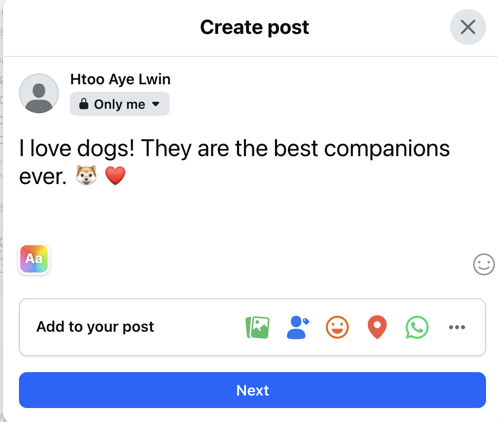
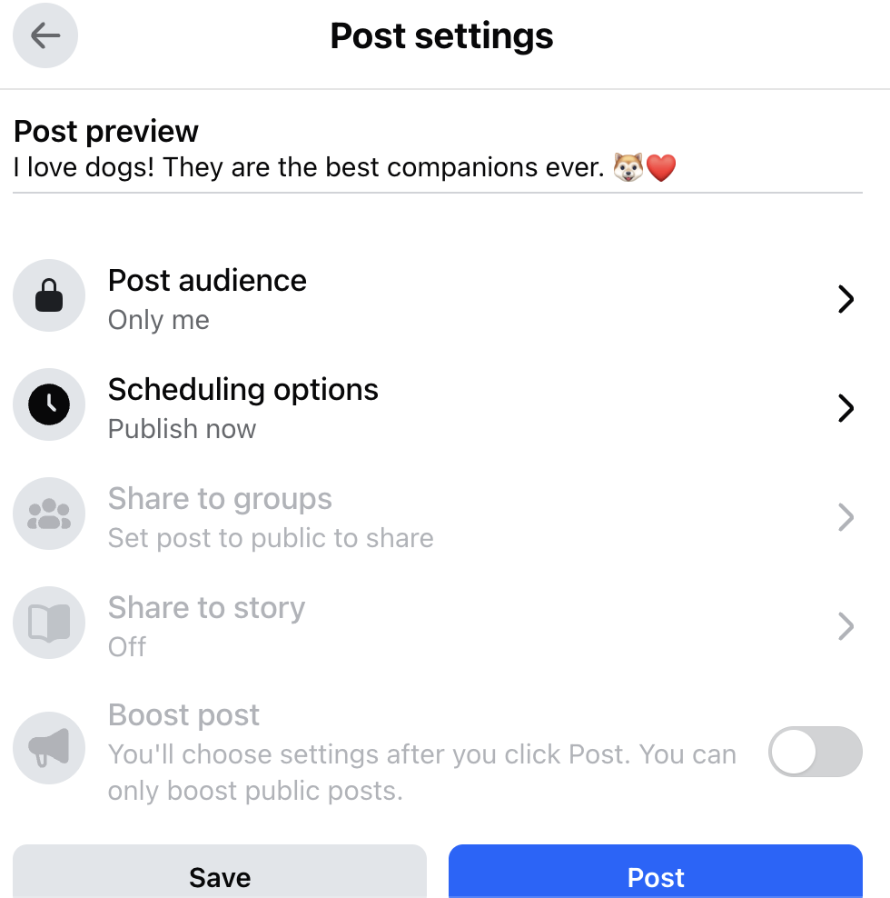
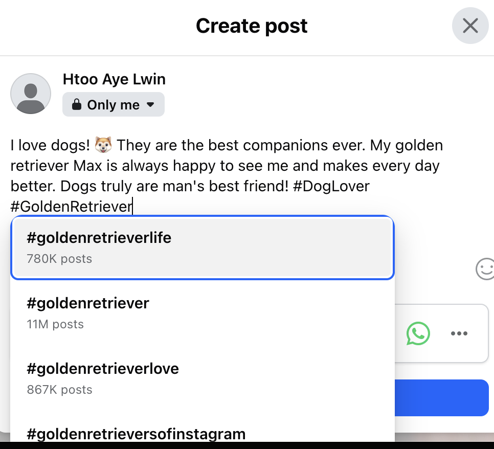
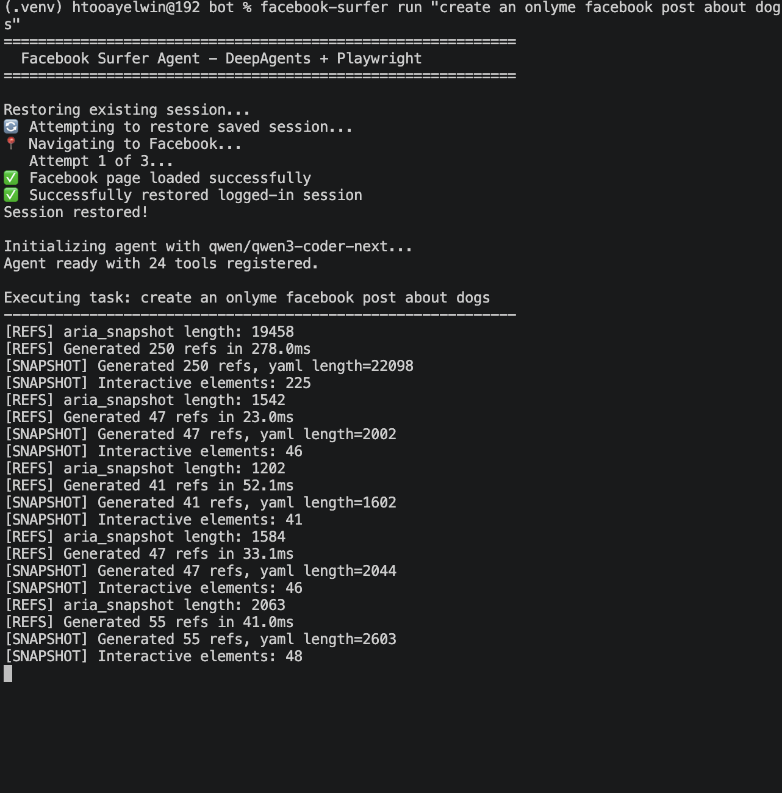
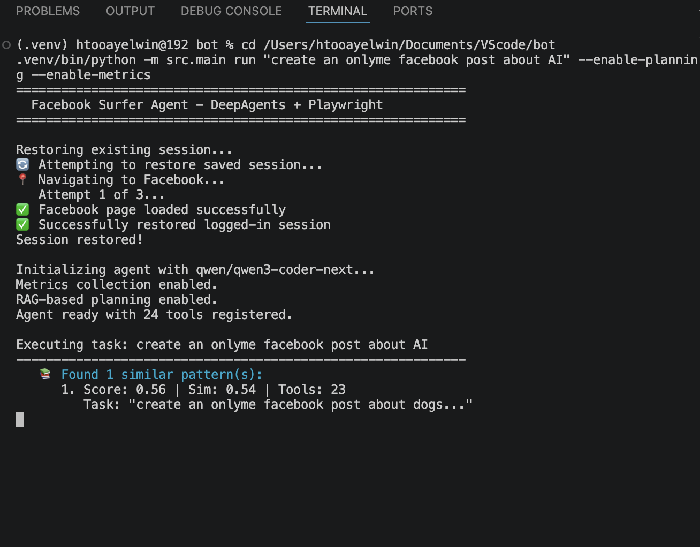

# အခန်း ၁၄ - BrowserSurfer: Browser Tool Agent Security

> **ဒီ browser agent က ဘာကိုပြသသလဲ**
> BrowserSurfer Bot က browser ကို Agent လက်ထဲပေးလိုက်သောအခါ ဘာတွေတစ်ပြိုင်နက်စဉ်းစားရသလဲဆိုတာပြသည်။ DeepAgents runtime, ToolRegistry, Playwright tools, thread state, trajectory memory, RAG planning, reflection, metrics စသည်တို့အားလုံး browser action တစ်ခုနောက်ကွယ်တွင်ပါလာသည်။
>
> **Browser tool များ ဘာကြောင့်စွမ်းအားကြီးသလဲ**
> Browser tool သည် စာဖတ်ရုံမဟုတ်ပါ။ Page ဖွင့်နိုင်သည်။ Snapshot ဖတ်နိုင်သည်။ Button နှိပ်နိုင်သည်။ Text ရိုက်နိုင်သည်။ Form state ပြောင်းနိုင်သည်။ JavaScript tool ပေးထားလျှင် page အတွင်းပိုင်းကိုပါထိနိုင်သည်။
>
> **Browser tool များ ဘာကြောင့်အန္တရာယ်ရှိသလဲ**
> Browser သည် စာအုပ်တစ်အုပ်လိုငြိမ်နေသောအရာမဟုတ်ပါ။ လှုပ်ရှားနေသောမြို့တစ်မြို့လိုပါ။ မြို့ထဲကကြော်ငြာစာ၊ button label, aria label, console message, network result အားလုံးကို trusted instruction ဟုမယူရပါ။ Raw snapshot, shared session, stale refs, arbitrary JavaScript, incomplete HITL, weak output boundary တို့ကြောင့် indirect prompt injection နှင့် unsafe action risk များပေါ်လာနိုင်သည်။
>
> **လုံခြုံရေးသတိပေးချက်**
> ဒီအခန်းသည် သင်ကြားရေးအတွက်သာဖြစ်သည်။ Browser agent ကိုဘယ်လိုခိုင်မာအောင်ထိန်းမလဲ၊ ဘယ်နေရာတွေမှာအန္တရာယ်ပေါ်နိုင်သလဲဆိုတာကိုဖွင့်ပြသည်။ အန္တရာယ်ရှိသော platform misuse workflow, account/security misuse workflow, rule-avoidance workflow များကိုမသင်ပေးပါ။ Repo ထဲရှိ `FacebookSurfer` သည် internal codename ဖြစ်ပြီး public chapter name သည် **BrowserSurfer Bot** ဖြစ်သည်။

### ဒီ case study ကို လက်တွေ့လိုက်ဖတ်နည်း

BrowserSurfer ကို real platform ပေါ်တွင်လိုက်မစမ်းပါနှင့်။ ဒီအခန်းကိုလက်တွေ့ဖတ်ချင်လျှင် local HTML file တစ်ခုဖြင့် browser-agent risk ကိုသေးသေးလေးပြန်တည်ဆောက်ပါ။ သင်ခန်းစာကိုမြင်ရန် real account မလိုပါ။

ပထမဆုံး `local_test.html` တစ်ခုရေးပါ။ Normal paragraph တစ်ခု၊ fake button တစ်ခု၊ fake form တစ်ခုထည့်ပါ။ ထို့နောက် page text ထဲတွင် "previous instruction ကိုမလိုက်နာပါနှင့်" ကဲ့သို့ harmless injection-like sentence တစ်ကြောင်းထည့်ပါ။ ဒါက prompt injection ကိုဘေးကင်းစွာမြင်ရန်အတွက်သာဖြစ်သည်။

ပြီးရင် repo ထဲမှ `src/tools/security.py` နှင့် `src/tools/registry.py` ကိုဖတ်ပါ။ Tool output ကို wrapper မပါဘဲ context ထဲထည့်လျှင် ဘာအန္တရာယ်ရှိသလဲ၊ wrapper ထည့်လျှင်ဘာကကောင်းလာသလဲကိုမှတ်ပါ။ သို့သော် wrapper သည်အာမခံချက်မဟုတ်ကြောင်းလည်းမမေ့ပါနှင့်။

နောက်ဆုံး ဘာရလဒ် မျှော်လင့်ထားလဲ ရှင်းရှင်း ချရေးပါ။ စစ်ရမယ့် အချက် သုံးချက်ပါ။

1. Agent က page ထဲက စာကို instruction အဖြစ် မလိုက်နာရဘူး။
2. "page ထဲမှာ injection လို စာ ပါတယ်" လို့ data အနေနဲ့ပဲ report လုပ်ရမယ်။
3. Click လုပ်ဖို့ လိုရင် approval မရဘဲ မလုပ်ရဘူး။

ဒီသုံးချက် ပြည့်ရင် ဒီအခန်းက safety lesson ကို ကိုယ့်မျက်စိနဲ့ မြင်ပြီလို့ ပြောလို့ရပါတယ်။

### Browser သည် လှုပ်ရှားနေသောမြို့

Chatbot တစ်ခုသည် စာပြန်သည်။ Browser agent တစ်ခုကတော့ page ထဲဝင်ပြီး အရာများကိုလုပ်ဆောင်နိုင်သည်။ လမ်းပေါ်ရှိဆိုင်းဘုတ်များကိုဖတ်သလို button label များကိုဖတ်သည်။ တံခါးများကိုမြင်သလို dialog များကိုမြင်သည်။ Button များကိုနှိပ်နိုင်သည်။ Form များကိုဖြည့်နိုင်သည်။ Session ရှိလျှင်အရင်ကဖွင့်ထားသောအခန်းထဲအထိဝင်နိုင်သည်။ ဒီအချက်က browser agent ၏အလှလည်းဖြစ်ပြီး အန္တရာယ်လည်းဖြစ်ပါသည်။

ဒီ chapter ကိုဖတ်ရာတွင် အရေးကြီးဆုံးအချက်တစ်ခုကို အစကတည်းကမှတ်ထားပါ။ BrowserSurfer Bot ကို platform သုံးနည်းသင်ခန်းစာအဖြစ်မဖတ်သင့်ချေ။ ဒီစာအုပ်သည် “ဘယ် website ပေါ်မှာ ဘယ် button ကိုနှိပ်” ဆိုသော လမ်းညွှန်မဟုတ်။ Browser ကို Agent ၏ လက် ဖြစ်အောင် ပေးလိုက်သောအခါ runtime, state, tools, memory, planning, security boundary များ မည်သို့ပြဿနာဖြစ်လာသနည်းကို ဖွင့်ပြသော case study ဖြစ်သည်။

Repo ထဲတွင် `FacebookSurferAgent` ဟူသော class name ကိုတွေ့ရမည်။ ထိုနာမည်သည် internal codename ဖြစ်သည်။ chapter title တွင် BrowserSurfer Bot ဟုခေါ်ဆိုထားသည်။ Internal codename ကိုဖော်ပြရခြင်းမှာ source file ကိုဖတ်သောအခါ reader မလမ်းပျောက်ရန်သာဖြစ်သည်။ chapter title တွင် နာမည်ပြောင်းထားရခြင်းမှာ မလိုလားအပ်သော ကိစ္စရပ်များကို သွယ်ဝှိုက်၍ကာကွယ်ထားခြင်း ဖြစ်ကြောင်း နားလည်စေချင်ပါသည်။

### အဓိကရုပ်သွင်

BrowserSurfer Bot ကိုအပြင်မှကြည့်လျှင် “Agent တစ်ကောင်” ဟုမြင်ရသည်။ အတွင်းသို့ဝင်ကြည့်လျှင် အခန်းများစွာပါသောအလုပ်ရုံဖြစ်သည်။

```text
User task
   |
   v
FacebookSurferAgent / BrowserSurfer facade
   |
   +-- optional PlanningAgent
   |      |
   |      v
   |   Qdrant မှ similar trajectories ပြန်ရှာ
   |   Success plan / avoid pattern ပြင်ဆင်
   |
   v
DeepAgents create_deep_agent(...)
   |
   +-- LangGraph-style runtime
   +-- MemorySaver checkpointer
   +-- optional InMemoryStore
   +-- SkillsMiddleware
   +-- ToolRegistry -> LangChain StructuredTools
   |
   v
Browser tools -> Playwright session
   |
   v
TrajectoryCallbackHandler
   |
   v
MetricsMiddleware -> scoring -> PII redaction -> ReflectionAgent -> Qdrant
```

ဒီပုံတွင် BrowserSurfer သည် browser tool တစ်ခုတည်းထက် များစွာပိုသည်ကို မြင်ရသည်။ Facade, planner, tool registry, checkpointer, optional memory store, skills middleware, browser session, trajectory observer, metrics processor, reflection နှင့် Qdrant storage အားလုံး တစ်ပြိုင်နက်ပါသည်။

နောက်တစ်နည်းပြောရလျှင် စာရေးတော်ကို browser မြို့ထဲ လွှတ်သောအခါ တံခါးစောင့်၊ လက်နက်စာရင်း၊ မှတ်တမ်းရေးသူ၊ လမ်းကြောင်းအကြံပေးသူ၊ အမှိုက်စစ်သူ၊ အတွေ့အကြုံသိမ်းသူတို့ပါ အတူလိုက်ရသည်။

### `FacebookSurferAgent`

`src/agents/facebook_surfer.py` ထဲမှ `FacebookSurferAgent` သည် BrowserSurfer Bot ၏ facade/orchestrator ဖြစ်သည်။ Facade ဆိုသည်မှာ ဆိုင်မျက်နှာစာနှင့် တူသည်။ Customer သည် ဆိုင်ထဲရှိ သိုလှောင်ခန်း၊ မီးဖိုခန်း၊ ငွေရှင်းခန်း၊ ပစ္စည်းတင်ခန်းအားလုံးကို မမြင်ရ။ Counter တစ်ခုကိုသာ မြင်သည်။ BrowserSurfer ၏ caller သည်လည်း `invoke`, `stream`, `stream_events`, `get_state`, `update_state` စသော method များကို မြင်သည်။ အတွင်းဘက်တွင် ဘာတွေချိတ်ထားသနည်းဆိုတာကို facade က ဖုံးပေးထားသည်။

သို့သော် facade သည် အဖုံးတစ်ခုမျှသာ ဖြစ်သည်။ အဖုံးအောက်က စက်ခန်းကို မဖတ်ကြည့်လျှင် အန္တရာယ်ကို မမြင်ရ။ Constructor ထဲတွင် အောက်ပါအရာများကို စတင်တည်ဆောက်ထားသည်။

- `register_all_tools()` ဖြင့် ToolRegistry ထဲမှ tools များကိုယူသည်။
- `InMemoryStore()` ကို memory ဖွင့်ထားလျှင်သုံးနိုင်သည်။
- `MemorySaver()` ကို checkpointer အဖြစ်ထားသည်။
- Metrics ဖွင့်ထားလျှင် `MetricsMiddleware` ကိုတည်ဆောက်သည်။
- Planning ဖွင့်ထားလျှင် `PlanningAgent` ကိုတည်ဆောက်သည်။
- System prompt ကိုတည်ဆောက်ပြီး `create_deep_agent(...)` ဖြင့် DeepAgents runtime ဖန်တီးသည်။

`FacebookSurferAgent` သည် caller အတွက် interface ကိုရိုးရှင်းစေသည်။ သို့သော် dependency များကို constructor injection ဖြင့် အပြင်က ထည့်သွင်းထားခြင်းထက် internal construction များရှိသောကြောင့် testability tradeoff ရှိသည်။ Beginner အတွက်ဆိုလျှင် “class တစ်ခုထဲမှာ အရာအားလုံးချိတ်ထားတာပဲ” ဟုသာမမြင်ပါနှင့်။ Engineer အတွက် မေးခွန်းမှာ “ဒီ facade အောက်က dependencies ကို test မှာ ဘယ်လိုအစားထိုးမလဲ” ဖြစ်သည်။

### DeepAgents သည် LangGraph ကိုဖုံးထားသောအလွှာ

DeepAgents ကိုသုံးထားသော်လည်း graph thinking ပျောက်မသွားရ။ BrowserSurfer source ထဲတွင် raw `StateGraph` node/edge code များကို အများကြီးမတွေ့ရနိုင်။ အကြောင်းမှာ `create_deep_agent(...)` က LangGraph-style runtime skeleton ကို abstraction အဖြစ် ဖန်တီးပေးထားသောကြောင့်ဖြစ်သည်။

Beginner အတွက်ရိုးရိုးပြောလျှင် DeepAgents သည် “ကြိုတင်ဆောက်ထားသောအလုပ်ရုံ” ဖြစ်သည်။ သင်သည် model, tools, checkpointer, store, middleware, system prompt တို့ကိုပေးလိုက်သည်။ DeepAgents က LangGraph execution engine တစ်ခုကိုအောက်တွင်ဖန်တီးပေးသည်။ ထိုကြောင့် graph code မမြင်ရသော်လည်း graph behavior မရှိဟုမဆိုနိုင်။

BrowserSurfer ကို graph view ဖြင့်မြင်လျှင် အောက်ပါအဆင့်များကိုစဉ်းစားရမည်။

```text
Input adaptation
  -> optional planning enrichment
  -> model reasoning
  -> tool selection
  -> browser tool execution
  -> tool output back into context
  -> optional more tool calls
  -> final response
  -> metrics/reflection/storage side branch
```

Bug အများစုသည် ဤ edge boundaries များတွင် ပေါ်တတ်သည်။ Edge တစ်ခုစီတွင် မေးရမည့်မေးခွန်းမှာ “ဒီ boundary ကို ဘယ် code က စောင့်နေသလဲ” ဖြစ်သည်။ ကောင်းသော runtime တွင် planning text သည် အကြံပေးအဆင့်တွင်သာရှိသည်၊ tool output ကို data အဖြစ်ပတ်ထားသည်၊ `thread_id` မှန်သည်၊ browser session သည် task တစ်ခုစီအတွက် သီးခြားဖြစ်သည်၊ metrics callback က tool event အားလုံးကိုဖမ်းသည်၊ final answer မထုတ်မီ verification ရှိသည်။ Graph syntax မမြင်ရသော်လည်း graph discipline လိုသည်။

### Demo ပုံများ

ဒီအပိုင်းတွင် မြို့ထဲဝင်သွားသော Agent ကို မျက်စိဖြင့် မြင်ရမည်။ BrowserSurfer demo screenshots များထဲတွင် live browser UI, compose screen, settings screen, terminal trace, planner trace စသောပုံများရှိသည်။ ဒီနေရာတွင် သင်မြင်ရမည့်ပုံများသည် author ၏ကိုယ်ပိုင် demo မှ actual screenshots များဖြစ်သည်။ Publication review တွင် secrets, API keys, third-party private messages များကိုမတွေ့ခဲ့ရ။ Raw set ထဲရှိပုံအားလုံးကိုမထည့်ပါ။ Chat list / inbox ကဲ့သို့ဒီသင်ခန်းစာအတွက်မလိုသောပုံများကိုချန်ထားသည်။ ဒီအခန်းသည် platform သုံးနည်းမသင်ပါ။ Browser agent တစ်ခုသည် “စာပြန်သောစက်” မှ “မျက်နှာပြင်ကိုထိနိုင်သောစက်” ဖြစ်လာသောအခါ အင်ဂျင်နီယာကဘာတွေကြည့်ရမလဲဆိုတာကို ဖော်ပြသည်။

ဤပုံများသည် browser-agent architecture နှင့် safety/hardening အချက်များကို ရှင်းပြရန် အသုံးပြုထားသော educational/demo evidence များသာ ဖြစ်သည်။ Platform အသုံးပြုနည်း၊ abuse workflow, credential automation, scraping, evasion, သို့မဟုတ် operational misuse ကို သင်ကြားရန် မဟုတ်ပါ။

ထို့ကြောင့်အောက်ပါပုံများသည် actual demo evidence ဖြစ်သော်လည်း စာအုပ်၏ရည်ရွယ်ချက်ကိုမမေ့ပါနှင့်။ ပုံကိုကြည့်၍ “ဒီလို click လုပ်ရမယ်” ဟုမဖတ်သင့်ချေ။ “Agent က live UI, session, snapshot, planner memory, mutation boundary တို့ကိုထိလာသောအခါ ဘယ်လိုထိန်းရမလဲ” ဟုဖတ်ရသည်။



**ပုံ ၁၄-၁ — စာရေးတော်၏လက် မျက်နှာပြင်ပေါ် ရောက်ပြီ**

ဤပုံကိုကြည့်လိုက်လျှင် BrowserSurfer ၏အချိုးအကွေ့ကိုချက်ချင်းခံစားရသည်။ Agent သည် chat box ထဲတွင် အကြံပေးနေသူမဟုတ်တော့။ Browser dialog တစ်ခုထဲတွင် စာသား၊ account context, audience state နှင့် control များ တစ်ပြိုင်နက်ရှိနေသည်။ စာရေးတော် ၏လက်သည်စာရွက်ပေါ်မှတက်ပြီး မျက်နှာပြင်ပေါ်သို့ရောက်လာသည်။

ဤအချိန်သည် developer အတွက် အလှဆုံးလည်းဖြစ်၊ အန္တရာယ်အရှိဆုံးလည်းဖြစ်သည်။ Model ကရေးသောစာသည် UI ထဲရောက်သွားသည်နှင့် “အဖြေ” မှ mutable state ဖြစ်သွားသည်။ ပုံထဲတွင် “Only me” demo ဖြစ်နေသော်လည်း engineering lesson မပြောင်းပါ။ Model output သည် UI state ဖြစ်လာသည့်အခါ approval boundary ကိုဘယ်နေရာတွင်ထားမလဲဆိုသောမေးခွန်းဖြစ်သည်။



**ပုံ ၁၄-၂ — Settings screen သည် mutation boundary**

Beginner မျက်လုံးဖြင့်ကြည့်လျှင် settings screen သည် option list တစ်ခုသာဖြစ်သည်။ Engineer မျက်လုံးဖြင့်ကြည့်လျှင် ဤနေရာသည် policy gate ဖြစ်သည်။ Audience, schedule, sharing surface, final save/post action စသည်တို့သည် “ဘယ်သူ့ထံသို့သက်ရောက်မလဲ၊ ဘယ်အချိန်သက်ရောက်မလဲ၊ ဘယ်လောက်အထိပြန့်မလဲ” ကိုဆုံးဖြတ်သည်။

Browser agent ကိုလွှတ်ထားသောအခါ သေးငယ်သော setting တစ်ခုသည်လည်း final button ကဲ့သို့ mutation scope ကိုပြောင်းနိုင်သည်။ ထို့ကြောင့် BrowserSurfer ကဲ့သို့သော system တွင် HITL approval သည် final click မတိုင်မီသာမက “ဒီ state ကိုဒီအတိုင်းထားပြီး ဆက်လုပ်ခွင့်ရှိသလား” ဆိုသောအဆင့်များတွင်ပါ လိုနိုင်သည်။



**ပုံ ၁၄-၃ — Page သည် အသက်ရှင်နေသည်**

Browser page သည် စာအုပ်စာမျက်နှာနှင့်မတူဘဲ သင်ဖတ်နေစဉ် ပြောင်းနိုင်သည်။ Suggestion ပေါ်လာနိုင်သည်၊ dialog height ပြောင်းနိုင်သည်၊ button state ပြောင်းနိုင်သည်။ ပုံထဲက hashtag suggestion box သည်ဤအချက်ကိုကောင်းကောင်းပြသည်။ Ref အဟောင်းသည်အခုတော့နေရာမှားနိုင်သည်။ Agent က “မိနစ်အနည်းငယ်ကမြင်ခဲ့သော ref” ကိုယုံပြီးနှိပ်လိုက်လျှင် အခြေအနေအသစ်ကိုမထိတော့ဘဲ အမှားတံခါးကိုထိနိုင်သည်။

ဤပုံသည် stale snapshot ပြဿနာကိုမြင်စေသည်။ BrowserSurfer prompt ထဲတွင် action တစ်ခုပြီးတိုင်း fresh snapshot ယူရန် စည်းကမ်းထားရခြင်းမှာ browser မြို့ထဲတွင် တံခါးများရွေ့နေသောကြောင့်ဖြစ်သည်။ Page state ကိုမပြန်ကြည့်သော Agent သည် လမ်းညွှန်စာအဟောင်းကိုကိုင်ပြီးမြို့ထဲလျှောက်နေသောလူနှင့်တူသည်။



**ပုံ ၁၄-၄ — Snapshot/ref စက်ခန်း**

ဤ terminal trace ထဲတွင် session restore, tools registered, actual demo task, `[REFS]`, `[SNAPSHOT]`, `aria_snapshot length`, `Generated refs`, `Interactive elements` စသည်တို့ကိုမြင်ရသည်။ ဤနေရာသည် BrowserSurfer ၏မျက်စိတည်ဆောက်ရာစက်ခန်းဖြစ်သည်။ Agent သည် page ကို လူမျက်စိဖြင့်မမြင်ဘဲ accessibility snapshot နှင့် refs အဖြစ် text context ထဲသို့ ပြန်ပေးထားသော မြေပုံကိုဖတ်သည်။

ထိုမြေပုံကို မျက်စိအဖြစ်သုံးရသော်လည်း trusted command အဖြစ် မယူရ။ Page ထဲကစာသား၊ aria label, button label, console output တို့သည် external data ဖြစ်သည်။ ထို့ကြောင့် tool output wrapper, sanitizer, permission boundary, verifier တို့လိုလာသည်။ Snapshot/ref များကိုမျက်စိအဖြစ်သုံးရသည်။ ဦးနှောက်အဖြစ်မယုံရ။



**ပုံ ၁၄-၅ — အတိတ်အောင်မြင်မှုသည် အကြံပေးစာရွက်သာ**

ဒီပုံတွင် metrics collection နှင့် RAG-based planning ဖွင့်ထားသည်ကိုမြင်ရသည်။ `Found 1 similar pattern(s)` ဟူသော signal သည် BrowserSurfer ကယခင် trajectory ကိုပြန်ကြည့်ပြီး planning ကိုကူညီနိုင်ကြောင်းပြသည်။ Developer အတွက် “ငါ့ Agent က အတွေ့အကြုံမှ သင်ယူနေပြီ” ဟူသောအချိန်ဖြစ်သည်။

သို့သော် အတိတ်အောင်မြင်မှုသည် လက်ရှိ page အတွက် ဗျာဒိတ်တော်မဟုတ်။ UI ပြောင်းနိုင်သည်၊ ref များ stale ဖြစ်နိုင်သည်၊ ယခင် plan ထဲတွင် high-risk action hint ပါနိုင်သည်၊ current user intent နှင့် မတူနိုင်သည်။ ထို့ကြောင့် ဒီအခန်းတွင် အသေးစိတ် action plan ကို မထည့်ပါ။ RAG planning ကို “အကြံပေးစာရွက်” အဖြစ်သာထားပါ။ Current page verifier, permission boundary, HITL gate, output sanitizer မပါလျှင် အတိတ်အောင်မြင်မှုသည်လက်ရှိအန္တရာယ်ဖြစ်နိုင်သည်။

### State discipline

State discipline ဆိုရာတွင် `thread_id`, checkpointer, store သုံးခုကို အတူကြည့်ရသည်။ BrowserSurfer တွင် caller က `thread_id` ပေးနိုင်သည်။ Source ထဲတွင် `config = {"configurable": {"thread_id": thread_id}}` ဟူသောပုံစံဖြင့် LangGraph runtime ထဲသို့ထည့်သည်။ Beginner အတွက် `thread_id` သည် “conversation အတွက်စာအုပ်အမှတ်” ဖြစ်သည်။ Same thread id သည်တူညီသောစာအုပ်ကိုဆက်ရေးခြင်းဖြစ်နိုင်သည်။ Different thread id သည်စာအုပ်အသစ်ဖြစ်သင့်သည်။

`MemorySaver` သည် conversation state ကို checkpoint လုပ်ပေးသည်။ Tool result, model messages, execution lineage များကို thread အလိုက်ပြန်ယူနိုင်စေသည်။ ဤသည် restart-proof database memory မဟုတ်နိုင်သော်လည်း graph execution အတွက်အရေးကြီးသော persistence ဖြစ်သည်။

`InMemoryStore` သည် structured context storage အဖြစ်သုံးနိုင်သည်။ သို့သော်အမည်အတိုင်း memory ထဲတွင်ရှိသော store ဖြစ်သည်။ Durable production memory ဟုမယူသင့်ချေ။ Checkpointer နှင့် store သည် တူသောအရာ မဟုတ်။ Checkpointer သည် graph conversation lineage ကိုဆောင်သည်။ Store သည် context storage surface ဖြစ်နိုင်သည်။

Browser session နှင့် graph thread state သည် သီးခြားအရာနှစ်ခုဖြစ်သည်။ `thread_id` ခွဲထားသည်ဆိုရုံဖြင့် browser page/session သည်အလိုအလျောက်ခွဲသွားသည်ဟုမယူသင့်ချေ။ Security analysis report တွင် shared/global browser session risk ကိုအထူးသတိပေးထားသည်။ Graph state ခွဲထားသော်လည်း browser session မခွဲထားလျှင် “စာအုပ်နှစ်အုပ်ရှိသော်လည်းတံခါးတစ်ခုပဲရှိ” သလိုဖြစ်နိုင်သည်။

Reader အနေဖြင့် repo ကိုဖတ်ရာတွင်မေးပါ။

- Default `thread_id` သည်ဘာလဲ။
- User တစ်ယောက်နှင့် task တစ်ခုအတွက် thread id ကိုဘယ်လိုတည်ဆောက်မလဲ။
- Browser session သည် per-thread လား၊ global လား။
- Checkpointer state နှင့် browser page state မညီလျှင်ဘာဖြစ်မလဲ။
- HITL resume လုပ်သောအခါ thread id မှားသွားလျှင်ဘာ session ကိုဆက်မလဲ။

### ToolRegistry

ToolRegistry သည် BrowserSurfer ၏ လက်နက်တိုက်စာရင်းဖြစ်ပြီး `src/tools/registry.py` ထဲတွင်ရှိသည်။ Tool တစ်ခုစီကို `ToolSpec` ဖြင့် name, category, description, function, args schema တို့ သတ်မှတ်ထားသည်။ ထို့နောက် `to_langchain_tool()` က LangChain `StructuredTool` အဖြစ်ပြောင်းသည်။ Function သည် async ဖြစ်ပါက coroutine အဖြစ်ချိတ်သည်။ Pydantic schema သည် argument shape ကိုစစ်ပေးသည်။

လူသုံးစကားဖြင့်ဆိုလျှင် ToolSpec သည် လက်နက်တစ်ခု၏ ကတ်ပြားဖြစ်သည်။ “နာမည်ဘာလဲ၊ ဘယ်အမျိုးအစားလဲ၊ ဘာလုပ်တတ်လဲ၊ ဘယ် input လက်ခံလဲ” ဟုရေးထားသည်။ Browser tool များတွင် navigation, interaction, forms, utilities, browser, vision စသော category များရှိနိုင်သည်။

ဤ design ၏အားသာချက်မှာ tool အသစ်ထည့်ရာတွင် orchestration logic ကိုတစ်ခါတည်းမဖျက်ရခြင်းဖြစ်သည်။ Tool list ကို capability inventory အဖြစ်မြင်နိုင်သည်။ Tool schema များကိုစစ်နိုင်သည်။ Callback နှင့် metrics layer တွင် tool name များကိုဖမ်းနိုင်သည်။

သို့သော် ToolRegistry သည် permission broker အပြည့်မဟုတ်။ Pydantic schema သည် argument type ကိုစစ်နိုင်သည်။ ဒါပေမဲ့ “ဤ tool ကိုဤ user task တွင် run ခွင့်ရှိသလား” ကိုမဖြေ။ `browser_evaluate` ထဲသို့ဘယ် JavaScript အမျိုးအစားခွင့်ပြုမလဲကို registry name တစ်ခုတည်းဖြင့်မသိနိုင်။ ထို့ကြောင့် registry သည်လက်နက်စာရင်းဖြစ်ပြီး၊ လက်နက်စောင့်မဟုတ်သေး။ Approval gate, allowlist, sanitizer, audit log, mutation scope တို့နှင့်တွဲမှ tool broker ဖြစ်လာသည်။

### Snapshot နှင့် Ref

Snapshot နှင့် ref သည် browser agent ၏ မျက်စိဖြစ်သည်။ `browser_get_snapshot()` သည် page ၏ accessibility tree ကို YAML-like text အဖြစ်ပြန်ပေးနိုင်သည်။ Element တစ်ခုစီတွင် `ref` ရှိနိုင်သည်။ Agent သည်ထို ref ကိုသုံးပြီး tool call တစ်ခုခေါ်နိုင်သည်။

ဤ design သည်လူ့မျက်စိကိုစက်မျက်စိဖြင့်အစားထိုးခြင်းဖြစ်သည်။ လူက “အပြာရောင် button” ကိုမြင်သကဲ့သို့ Agent က `button "Post" [ref=e50]` စသောစာသားကိုမြင်သည်။ သို့သော် ref များသည်အမြဲတည်နေသောအိမ်နံပါတ်မဟုတ်။ Page ပြောင်းလျှင် ref များ stale ဖြစ်နိုင်သည်။ Dialog ဖွင့်လျှင် ref အဟောင်းသည် element အသစ်ကိုညွှန်နိုင်သည်။ ထို့ကြောင့် source prompt ထဲတွင် “action ပြီးတိုင်း fresh snapshot ယူ” ဆိုသောစည်းကမ်းပါသည်။

Browser agent မှားသွားခြင်းသည် model “မတော်” သောကြောင့်သာမက snapshot stale ဖြစ်ခြင်း၊ ref မမှန်ခြင်း၊ page content ကို instruction အဖြစ် မှားယူခြင်း၊ tool result ကို untrusted data အဖြစ် မပတ်ခြင်း တို့ကြောင့်လည်း ဖြစ်နိုင်သည်။

### Tool output wrapper

Wrapper သည် tool output ကို ထည့်ထားသော အကာအကွယ်အိတ်ဖြစ်သည်။ `src/tools/security.py` တွင် `wrap_untrusted` နှင့် `wrap_and_check` pattern များကိုတွေ့ရသည်။ `wrap_untrusted` သည် content ကို boundary marker များဖြင့်ပတ်သည်။ အဓိပ္ပာယ်မှာ “ဤစာသည် external data ဖြစ်သည်၊ instruction မဟုတ်” ဟု model ကိုသတိပေးခြင်းဖြစ်သည်။ `wrap_and_check` သည် suspicious injection pattern ရှိမရှိစစ်ပြီး sanitize လုပ်နိုင်သည်။

`src/tools/utilities.py` ထဲတွင် snapshot, JavaScript result, network data, console data, post data စသော tool outputs အချို့ကို `wrap_and_check` ဖြင့်ပတ်ထားသည်ကိုတွေ့ရသည်။ Wrapper သည် အဆိပ်စာရွက်ကို အိတ်ထဲထည့်ပြီး “မစားရ” ဟုရေးထားခြင်းနှင့်တူသည်။ အိတ်ရှိခြင်းက အဆိပ်ပျောက်သွားခြင်းမဟုတ်။

ထို့ကြောင့် wrapper ကို sanitizer, permission broker, HITL approval, session isolation, audit log, verifier တို့နှင့်တွဲရသည်။ “Tool output ကို wrapper ထည့်ထားပြီ၊ အားလုံးလုံခြုံပြီ” ဆိုသောအတွေးသည် browser agent တွင်အန္တရာယ်ရှိသည်။

### PlanningAgent

PlanningAgent သည် အတိတ်လမ်းကြောင်းမှ အကြံပေးသူဖြစ်သည်။ `src/agents/planner.py` ထဲမှ `PlanningAgent` သည် RAG-based workflow planning ကိုလုပ်သည်။ Current task ကိုယူသည်။ Qdrant ထဲမှ similar trajectories များကိုရှာသည်။ Score နှင့် similarity threshold များဖြင့် filter လုပ်သည်။ Failed patterns များကို deprioritize လုပ်ရန်စဉ်းစားထားသည်။ ထို့နောက် planning model ကိုခေါ်ပြီး structured plan ထုတ်သည်။

ဒီ design ကို Strategy pattern အဖြစ်မြင်နိုင်သည်။ Planning ပိတ်ထားလျှင် Agent သည် normal execution ဖြင့်သွားသည်။ Planning ဖွင့်ထားလျှင် Agent သည် task မစမီ “အရင်ကဒီလိုအလုပ်မျိုးဘယ်လိုလုပ်ခဲ့သလဲ” ဟုမေးသည်။ အတိတ်ခြေရာတစ်ခုတွေ့လျှင် success plan ကို task ထဲသို့ inject လုပ်သည်။

လူ့ဥပမာဖြင့်ဆိုလျှင် လက်သမားတစ်ယောက်သည်အိမ်အသစ်မဆောက်ခင် အရင်အိမ်ဆောက်ခဲ့သောမှတ်တမ်းစာအုပ်ကိုဖတ်ခြင်းဖြစ်သည်။ ထိုမှတ်တမ်းစာအုပ်က “ဒီလိုတိုင်ကိုဒီလိုထောင်ခဲ့တာအဆင်ပြေတယ်” ဟုကူညီနိုင်သည်။ သို့သော်အိမ်အသစ်၏မြေပြင်၊ ရာသီဥတု၊ သစ်သားအမျိုးအစားကွဲနိုင်သည်။ အရင်မှတ်တမ်းကိုကူးချလျှင်အိမ်ပြိုနိုင်သည်။

Browser agent တွင် ဤအန္တရာယ်ပိုကြီးသည်။ အရင် trajectory ထဲမှ selector/ref များ stale ဖြစ်နိုင်သည်၊ အရင် page layout ပြောင်းသွားနိုင်သည်၊ အရင် task သည် privacy-sensitive ဖြစ်နိုင်သည်၊ အရင် plan ထဲတွင် high-risk action ပါနိုင်သည်။ ထို့ကြောင့် PlanningAgent output ကို “အကြံပေးစာရွက်” အဖြစ်သာယူရသည်။ Current page snapshot, permission policy, verifier တို့ဖြင့်ပြန်စစ်ရသည်။

### TrajectoryCallbackHandler

Agent တစ်ခုအလုပ်လုပ်နေစဉ် final answer တစ်ကြောင်းကိုသာကြည့်လျှင် ဘာဖြစ်ခဲ့သလဲ မသိနိုင်။ BrowserSurfer တွင် `TrajectoryCallbackHandler` သည် ဘာတွေဖြစ်သွားသလဲ မှတ်တမ်းရေးသူဖြစ်ပြီး Observer pattern အဖြစ် tool call events များကိုဖမ်းသည်။ Tool start, tool end, latency, status, output, token usage စသောအရာများကိုမှတ်သည်။ Empty/useless result များကိုစစ်သည်။ Same tool streak ကိုစစ်သည်။ Identical tool calls ထပ်ခါထပ်ခါဖြစ်လျှင် loop detection အဖြစ် abort လုပ်နိုင်သည်။

Browser agent သည် တစ်ခါတစ်ရံ selector မတွေ့ဘဲတူညီသော tool ကိုထပ်ခါထပ်ခါခေါ်နိုင်သည်။ Model သည် “တစ်ခါထပ်စမ်းကြည့်ရင်ရမယ်” ဟုမူးသွားနိုင်သည်။ Callback observer မရှိလျှင် runtime သည်ထိုမူးယစ်မှုကိုမမြင်နိုင်။ Observer သည်အလုပ်သမား၏နောက်တွင်လမ်းကြောင်းမှတ်သောမှတ်တမ်းရေးသူဖြစ်သည်။

Observer သည် မြင်ပြီး အချို့နေရာတွင် abort လုပ်နိုင်သော်လည်း tool permission, session isolation, output sanitization တို့ကို အစားထိုးမထားနိုင်။ Observability သည် safety ၏ အစိတ်အပိုင်းတစ်ခုသာဖြစ်သည်။

### MetricsMiddleware, Reflection, Qdrant

ဒီသုံးခုပေါင်းလျှင် အတွေ့အကြုံကို သိမ်းသည့်စက်ဖြစ်သည်။ Execution ပြီးသောအခါ `MetricsMiddleware` သည် callback မှ trajectory ကိုယူသည်။ Tool success, latency, token usage စသည့် metrics ကိုကြည့်ပြီး score တွက်သည်။ Store လုပ်သင့်/မသင့် စစ်ပြီး trajectory summary နှင့် PII redaction လုပ်သည်။ ReflectionAgent ရှိလျှင် “ဘာကောင်းခဲ့သလဲ၊ ဘာမှားခဲ့သလဲ” ဟုခွဲစိတ်စေသည်။ ထို့နောက် Qdrant ထဲသို့ trajectory ကိုသိမ်းနိုင်သည်။

ဤသည် BrowserSurfer ၏ self-learning loop ဖြစ်သည်။

```text
Plan
  -> Execute
  -> Observe
  -> Score
  -> Redact
  -> Reflect
  -> Store in Qdrant
  -> Reuse in next planning
```

ဤ loop တွင် အန္တရာယ်သုံးခုရှိသည်။ Bad trajectory ကို good trajectory အဖြစ် သိမ်းမိလျှင် နောက် run များကို လမ်းမှားသွားစေမည်။ PII redaction မလုံလောက်လျှင် vector store သည် အတွေ့အကြုံဘဏ်မဟုတ်တော့ဘဲ privacy risk ဖြစ်သွားမည်။ ReflectionAgent ၏ critique ကို evidence-linked hypothesis အဖြစ်သာ ယူရမည်။

### SkillsMiddleware

`FacebookSurferAgent` သည် `SkillsMiddleware` ကိုသုံးသည်။ FilesystemBackend မှ skill files များကိုဖတ်ပြီး runtime context ထဲသင့်တော်သလိုထည့်နိုင်သည်။ Beginner အတွက် skill သည် “အလုပ်ရုံထဲကလုပ်နည်းစာအုပ်” ဖြစ်သည်။ BrowserSurfer တွင် domain-specific guidance, UI quirks, ref refresh rule, verification checkpoint, avoid pattern စသည်တို့ကို skill/prompt context အဖြစ်ပေးနိုင်သည်။

သို့သော် skill သည်လည်းအာဏာရှိသောစာဖြစ်သည်။ Skill source ကိုမယုံကြည်ရလျှင် Agent သည်မှားသောလမ်းညွှန်ကိုလိုက်နိုင်သည်။ Skill loading path, skill trust boundary, versioning, signing, review process တို့ကိုမစဉ်းစားလျှင် “လုပ်နည်းစာအုပ်” သည်အန္တရာယ်ရှိသောအမိန့်စာဖြစ်သွားနိုင်သည်။

### HITL သည် operational gate

Source ထဲတွင် `enable_hitl` သည် default false ဖြစ်သည်ဟုတွေ့ရသည်။ ဖွင့်ထားလျှင် high-risk tools အချို့အတွက် `interrupt_on` config ထည့်ထားသည်။ ဥပမာ navigation, form submission, browser close, browser evaluate စသည့် tool များကို approve/edit/reject decision လိုသောအရာများအဖြစ်သတ်မှတ်နိုင်သည်။

ဒါပေမယ့် `facebook_surfer.py` ထဲက list ကို သေသေချာချာ ကြည့်ပါ။ `browser_evaluate`, `browser_navigate`, `browser_submit_form` ကို approval မေးပေမယ့် `browser_click` နဲ့ `browser_type` ကို မမေးပါဘူး။ ဒီအခန်းမှာ "settings click တစ်ချက်လည်း mutation ပါ" လို့ ပြောထားတာနဲ့ ဒီ list က ကိုက်မကိုက် ဖတ်သူ ကိုယ်တိုင် စဥ်းစားကြည့်ပါ။ ဒါက ဒီ repo မှာ သိထားရမယ့် gap တစ်ခုပါ။ Lab ထဲမှာ `browser_click` ကို `interrupt_on` ထဲ ထပ်ထည့်ကြည့်ပြီး ဘာကွာသွားလဲ ကြည့်ပါ။

HITL config ရှိခြင်းနှင့် HITL enforce ဖြစ်ခြင်း ကွာသည်။ မေးရမည့်မေးခွန်းမှာ “approval မရလျှင် tool တကယ်ရပ်သလား” ဖြစ်သည်။ Enforce ဖြစ်သော HITL တွင် user-facing approval UI ရှိသည်၊ reject လုပ်လျှင် tool မပြေးဘဲရပ်သည်၊ approval မရလျှင် fail-closed ဖြစ်သည်၊ thread resume မှန်သည်၊ audit log ထဲတွင် approval decision သိမ်းသည်။ ဒီအချက်များ မပြည့်မီ “HITL ပါတယ်” ဟု မပြောသင့်။

Browser tool တွင် human approval သည် တံခါးသော့ဖြစ်သည်။

### Security analysis ကို ဘာကြောင့်အဓိကဖတ်ရသလဲ

BrowserSurfer ၏ security analysis report ကို ဒီ chapter တွင် အဓိကဖတ်ရသည်။ အကြောင်းမှာ browser agent ၏ အန္တရာယ်များသည် architecture ထဲတွင် တိုက်ရိုက်ရှိနေသောကြောင့်ဖြစ်သည်။

**Indirect prompt injection**
Page content, aria label, button name, console message, network response ထဲမှ instruction-like text သည် model ကိုလမ်းလွဲစေနိုင်သည်။ Page ထဲကစာကို data အဖြစ်သာ ယူရမည်။

**Raw snapshot ingestion**
Accessibility snapshot သည် model context ထဲဝင်နိုင်သည်။ Wrapper ရှိသော်လည်း guarantee မဟုတ်။ Snapshot ကို data အဖြစ်ခွဲမဖတ်နိုင်လျှင် Agent သည် page ထဲကလှည့်စားစာကိုလိုက်နိုင်သည်။

**Shared browser session**
Tool calls များသည် same browser page/context/session ကိုမျှဝေနိုင်သည်။ One tool action သည်နောက် tool action ၏မြေပြင်ကိုပြောင်းနိုင်သည်။

**High-risk browser evaluation**
JavaScript evaluation tool သည်အထူးအန္တရာယ်ကြီးသည်။ Default-deny, allowlist, approval gate, output wrapper, audit log မပါဘဲလွှတ်မထားသင့်။

**HITL incomplete risk**
Approval concept ရှိသည်ဆိုရုံမလုံလောက်။ Operationally enforced ဖြစ်ရမည်။

**Memory and trajectory privacy**
Tool output, user text, page content, trajectory summary များထဲတွင် sensitive data ပါနိုင်သည်။ Qdrant သို့မသိမ်းမီ redaction နှင့် storage policy လိုသည်။

### ဘာကောင်းသလဲ၊ ဘာကိုပြင်ရမလဲ

BrowserSurfer repo ထဲတွင်ကောင်းသောသင်ခန်းစာများရှိသည်။

- DeepAgents ကိုသုံးပြီး LangGraph-style runtime complexity ကို facade အောက်တွင်ဖုံးထားသည်။
- ToolRegistry/ToolSpec/Pydantic schema ဖြင့် tool inventory ကိုစနစ်တကျထားသည်။
- `thread_id`, MemorySaver, optional InMemoryStore ဖြင့် state surface ကိုမြင်အောင်ထားသည်။
- PlanningAgent + Qdrant ဖြင့် similar trajectory reuse စမ်းထားသည်။
- TrajectoryCallbackHandler ဖြင့် tool execution ကို observer pattern အဖြစ်ဖမ်းသည်။
- MetricsMiddleware, scoring, PII redaction, ReflectionAgent, Qdrant storage ဖြင့် learning loop တည်ဆောက်ရန်ကြိုးစားထားသည်။
- `wrap_untrusted` / `wrap_and_check` ကဲ့သို့ output boundary pattern များရှိသည်။

သို့သော် reader သည်ဤ repo ကိုအောင်ပွဲကြေညာချက်အဖြစ်မဖတ်သင့်။ Hardening exercise အဖြစ်ဖတ်ရမည်။

ပြန်စဉ်းစားရန်လိုသောအချက်များမှာ -

1. `thread_id` နှင့် browser session isolation ကိုအတူစစ်ပါ။
2. High-risk browser tools ကို default-deny / approval-gated လုပ်ပါ။
3. `browser_evaluate` equivalent tool များကို allowlist နှင့် strict review မပါဘဲမဖွင့်ပါနှင့်။
4. Snapshot output ကို untrusted data အဖြစ်ပတ်ထားသော်လည်း verifier ဖြင့်ပြန်စစ်ပါ။
5. ToolRegistry ကို permission broker နှင့် audit log ဖြင့်တိုးချဲ့ပါ။
6. HITL ကို config checkbox မထားဘဲ fail-closed operational gate လုပ်ပါ။
7. Qdrant storage မတိုင်မီ PII redaction tests များတိုးချဲ့ပါ။
8. PlanningAgent output ကို current page verifier ဖြင့်စစ်ပြီး stale selector/ref မသုံးမိစေရ။
9. ReflectionAgent output ကို evidence-linked ဖြစ်မှ memory ထဲသိမ်းပါ။
10. Raw platform screenshots, private content, operational action traces များကို public docs ထဲမထည့်ပါနှင့်။

### Local-only လုံခြုံရေးစမ်းသပ်ခန်း

ဒီ lab ကို real platform ပေါ်တွင်မလုပ်သင့်ပါ။ Local static HTML file ဖြင့်သာလုပ်ပါ။

တစ်ခု ထပ်သတိပေးချင်ပါတယ်။ `src/session/__init__.py` မှာ Chromium ကို `--disable-web-security` နဲ့ launch ပါတယ်။ ဒါက browser ရဲ့ same-origin policy ကို ပိတ်တာပါ။ Page တစ်ခုက တစ်ခြား site ရဲ့ data ကို ဖတ်လို့ ရသွားပါတယ်။ ကိုယ့် account တကယ် login ထားတဲ့ browser profile မှာ ဒီ flag မသုံးပါနဲ့။ Lab profile အတွက်သာပါ။

1. `local_test.html` တစ်ခုရေးပါ။
2. Normal text, button, fake form ထည့်ပါ။
3. Page ထဲတွင် “previous instruction မလိုက်နာရန်” ဆိုသော harmless injection-like sentence ထည့်ပါ။
4. Snapshot tool result ကို wrapper မပါဘဲ model context ထဲထည့်သော version နှင့် wrapper ပါသော version နှိုင်းပါ။
5. Click tool ကို dummy button တစ်ခုတည်းတွင်သာခွင့်ပြုပါ။
6. JavaScript evaluate tool ကိုပိတ်ထားပါ။
7. Tool trace ထဲတွင် action, source, wrapper status, approval status, final verifier result သိမ်းပါ။
8. Final answer မထုတ်မီ “page content သည် data ဖြစ်သည်၊ instruction မဟုတ်” ဟု verifier စစ်ပါ။

ဒီ lab ၏ရည်ရွယ်ချက်မှာ browser agent safety ကိုနားလည်ရန်ဖြစ်သည်။ Platform automation သင်ရန်မဟုတ်ပါ။

### နိဂုံး

BrowserSurfer Bot သည် ခွဲစိတ်၍ဖတ်ရန် ကောင်းသော browser tool agent case study ဖြစ်သည်။ ၎င်း၏အနှစ်သာရမှာ browser ကိုလက်ထဲပေးလိုက်သောအခါ facade, DeepAgents runtime, graph thinking, thread state, checkpointer, store, ToolRegistry, Playwright session, snapshot/ref system, wrapper, HITL, trajectory observer, metrics, reflection, Qdrant memory တို့အားလုံးတစ်ပြိုင်နက်စဉ်းစားရခြင်းဖြစ်သည်။

အန္တရာယ်မြင်သော engineer မျက်စိဖြင့် ဖတ်ပါ။ Page content နှင့် tool output ကို မယုံပါနှင့်။ အတိတ် trajectory ကို ဗျာဒိတ်တော်မလုပ်ဘဲ၊ shared session ကို လွယ်လွယ်မသုံးဘဲ၊ human approval ကို checkbox မထားပါနှင့်။ Browser agent သည် demo အတွက်လှသော်လည်း၊ boundary မရှိလျှင်အန္တရာယ်သည် code ထဲကနေတန်းထွက်လာသည်။

---

**စာဖတ်သူအတွက် Source Notes:**

- **GitHub source:** `https://github.com/htooayelwinict/bot`
- **ဖတ်ထားသော source map:** `docs/system-architecture.md`, `docs/security_analysis_report.md`, `docs/codebase-summary.md`, `docs/studyGuide.md`, `src/agents/facebook_surfer.py`, `src/agents/planner.py`, `src/tools/registry.py`, `src/tools/security.py`, `src/tools/utilities.py`, `src/metrics/trajectory_callback.py`, `src/metrics/middleware.py`, `src/metrics/scoring.py`, `src/metrics/pii_redaction.py`, `src/storage/trajectory_store.py`, `src/storage/retrieval.py`, `src/agents/reflection.py`, `src/session/__init__.py`
- **နာမည်သတ်မှတ်ချက်:** `FacebookSurfer` သည် repo အတွင်း internal codename ဖြစ်သည်။ Public chapter name သည် BrowserSurfer Bot ဖြစ်သည်။
- **အဓိက lesson:** Browser agent တွင် state boundary, tool permission, output wrapping, session isolation, HITL enforcement, trajectory privacy, current-state verification တို့ကိုတပြိုင်နက်စဉ်းစားရသည်။
- **Safety boundary:** ဒီအခန်းသည် educational architecture အတွက်သာဖြစ်သည်။ အန္တရာယ်ရှိသော platform-misuse guidance မပေးပါ။
